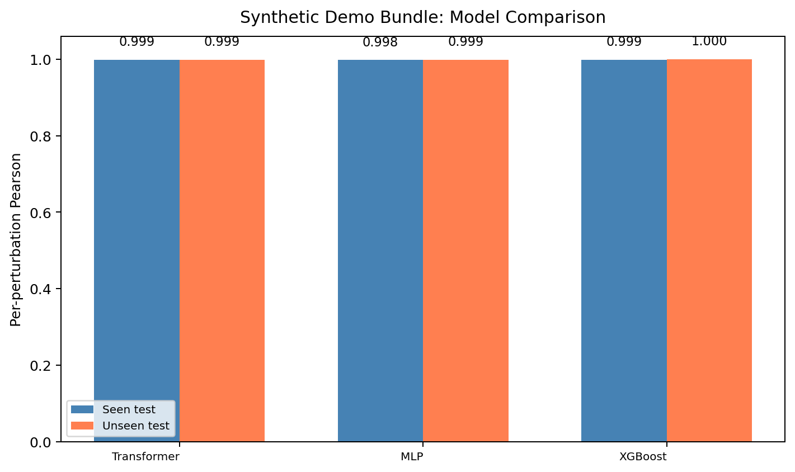
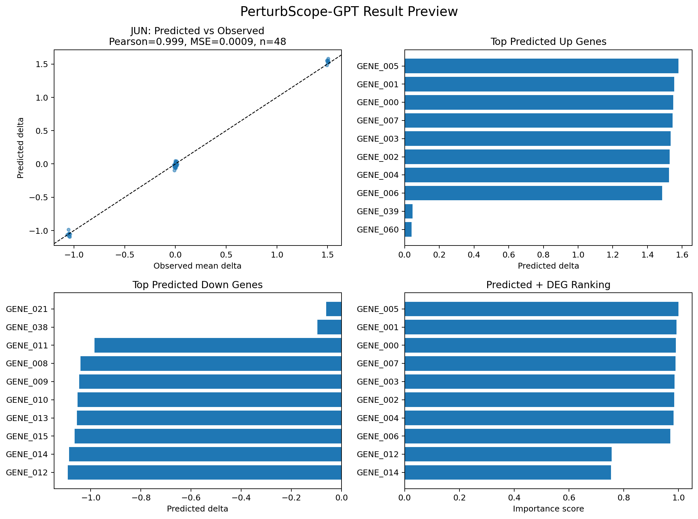
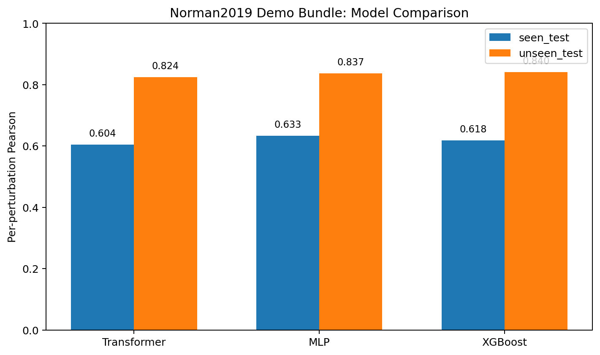
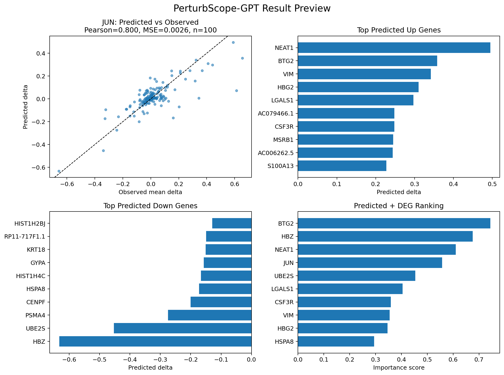

# PerturbScope-GPT

> Local-first Transformer for single-cell perturbation response prediction,
> trained on Norman2019 (K562 · 10,500 cells · 512 HVGs · 105 single-gene conditions).

**Tech stack:** Python 3.11 · PyTorch · scanpy · scikit-learn · XGBoost · Streamlit · uv

[](https://github.com/musuntana/scgpt/actions/workflows/ci.yml)

## Key Results (Norman2019, historical artifacts)

| Model | Reported unseen-split Pearson† | Reported unseen-split MSE† | Reported top-100 DEG overlap† |
| --- | ---: | ---: | ---: |
| Transformer | 0.824 | 0.0011 | **0.976** |
| MLP | 0.837 | 0.00085 | — |
| XGBoost | 0.840 | 0.00084 | — |

**Evaluation caveat:** These values are historical outputs from legacy artifacts and are
retained for traceability. Those bundles used pre-split gene filtering/HVG selection, and
the earlier training scripts evaluated both test protocols with the same checkpoint. The
current CLI uses split-aware feature selection and training scripts now emit only metrics
for the matching test protocol. Existing bundles and metrics are not retroactively fixed.
The categorical perturbation-ID embeddings still do not establish zero-shot generalization
to identities absent from training. See
[`docs/evaluation-protocol-audit.md`](docs/evaluation-protocol-audit.md).

The next model-architecture step is to benchmark a mature implementation before
building a new perturbation representation. The current candidate and integration
constraints are documented in
[`docs/perturbation-modeling-options.md`](docs/perturbation-modeling-options.md);
GEARS remains an optional candidate until split and target compatibility are verified.
The GEARS preflight replays the exact training-only preprocessing, verifies all bundle
arrays/splits, and exports a GEARS-schema `gears_input.h5ad` with exact cell IDs and split
labels. An optional runtime runner now uses official GEARS model/data components with a
custom all-gene validation loop, avoids condition-level DE/dropout preprocessing, and
checks GO-graph coverage before training. It reports absolute-expression metrics only;
control-relative delta equivalence remains unverified. See
[`docs/gears-preflight.md`](docs/gears-preflight.md).

The previously recorded three-seed Transformer aggregate is 0.830 +/- 0.007 reported
unseen-split Pearson and 0.985 +/- 0.007 reported unseen-split top-100 DEG overlap; the
same caveat applies.

See [Real Norman2019 results](#real-norman2019-results) for per-split tables and figures.

> Provenance guardrail: unless a section is explicitly labeled **synthetic**, metrics in this
> README refer to the real Norman2019 run. The synthetic showcase exists only for offline
> pipeline/UI demos and must not be cited as biological performance.

## Quick Start

No dataset download required to try the offline demo:

```bash
# 1. Set up environment
./scripts/bootstrap_env.sh && source .venv/bin/activate

# 2. Generate offline synthetic showcase (trains all three models)
./scripts/run_generate_synthetic_showcase.sh

# 3. Launch Streamlit app
./scripts/run_app.sh
```

This quick start uses the **synthetic offline showcase**. It is intended for product/demo validation,
not for reporting real perturbation biology results.

For the full Norman2019 real-data flow, see [Real Norman2019 workflow](#real-norman2019-workflow) below.

## Project Goal

Build a job-ready MVP that can:
- preprocess public Perturb-seq data into a reproducible training set
- predict perturbation-induced expression changes with a Transformer
- compare against MLP and XGBoost baselines
- produce DEG-based target rankings
- expose inference results in a Streamlit demo

See [`docs/architecture.md`](docs/architecture.md) for model and data-flow details.

## Local-First MVP Scope

- dataset: `scPerturb / Norman2019`
- sample scope: single-gene perturbations only
- target: `delta expression`
- primary metric: `per-perturbation Pearson`
- default HVG count: `512`

## Environment

This repository now uses `uv` as the default environment and dependency manager.

- Python version: `3.11`
- local virtual environment: `.venv`
- local uv cache: `.uv-cache`
- dependency source of truth: [`pyproject.toml`](pyproject.toml)
- locked dependency snapshot: [`uv.lock`](uv.lock)

### Bootstrap

Create the local development environment:

```bash
./scripts/bootstrap_env.sh
```

This will:
- create `.venv` in the current repository
- install Python `3.11` if `uv` needs to fetch it
- sync runtime and dev dependencies with `uv`

### Activate

```bash
source .venv/bin/activate
```

You can also avoid manual activation and run everything through `uv run` or the shell wrappers in `scripts/`.

## Experiment Provenance

Training run summaries include Git revision/dirty state, runtime versions, split protocol and
seeds, and SHA-256 fingerprints for configuration files, processed bundle files, the raw
dataset when available, and the checkpoint. See
[`docs/reproducibility.md`](docs/reproducibility.md) for field definitions and how to
decide whether two runs are comparable.

## Main Commands

Run tests:

```bash
./scripts/run_tests.sh
# or
make test
```

Run linting and type checking:

```bash
make lint        # ruff check --fix
make typecheck   # mypy src/
```

Inspect local project/demo readiness:

```bash
./scripts/run_doctor.sh
# or
make doctor
```

The doctor command checks:
- core repository files (`README.md`, `PROJECT_PLAN.md`, `pyproject.toml`, `uv.lock`, CI workflow)
- local environment pinning (`.python-version`, `.venv`)
- notebooks
- offline synthetic demo artifacts
- real Norman2019 bundle and result artifacts
- model-comparison summaries for MLP and XGBoost

Export an interview-friendly project snapshot:

```bash
./scripts/run_snapshot.sh
# or
make snapshot
```

Useful variants:

```bash
./scripts/run_snapshot.sh --json
./scripts/run_snapshot.sh --output-path artifacts/project_snapshot.json
```

The snapshot command summarizes:
- project readiness modes from `doctor`
- headline real-data results across Transformer / MLP / XGBoost
- Transformer DEG-overlap highlights
- Transformer multi-seed stability when `artifacts/multi_seed_report.json` is available
- Transformer error-analysis highlights when `*_error_summary.json` artifacts are available
- key demo asset paths
- recommended commands for a live walkthrough

Prepare a live interview/demo flow:

```bash
./scripts/run_showcase.sh
# or
make showcase
```

Launch the showcase and open the app immediately:

```bash
./scripts/run_showcase.sh --launch-app
```

The showcase command:
- reuses real Norman2019 artifacts when available
- regenerates the offline synthetic showcase only when needed
- writes `artifacts/project_snapshot.json`
- surfaces a talk track for stability plus failure-case highlights when saved diagnostics exist
- prints the recommended order for a live walkthrough

Export an interview speaking script:

```bash
./scripts/run_pitch.sh
# or
make pitch
```

Useful variants:

```bash
./scripts/run_pitch.sh --track ai4bio
./scripts/run_pitch.sh --track ml-engineering
./scripts/run_pitch.sh --json
./scripts/run_pitch.sh --output-path artifacts/interview_script.txt
```

The pitch command includes:
- 30-second project intro
- 2-minute technical walkthrough
- real Transformer multi-seed stability when available
- saved error-analysis / failure-case talking points when available
- live demo script
- honest limitations
- next-step talking points
- suggested answers to common interviewer questions

Install pre-commit hooks (runs ruff automatically before each commit):

```bash
source .venv/bin/activate
pre-commit install
```

Start the Streamlit app:

```bash
./scripts/run_app.sh
```

The app prefers the real local demo artifacts when they exist:
- bundle: `data/processed/norman2019_demo_bundle`
- artifact dir: `artifacts/transformer_seen_norman2019_demo`
- checkpoint: `<artifact dir>/best_model.pt`

Offline fallback when raw data download is unavailable:

```bash
./scripts/run_generate_synthetic_demo.sh
```

This generates a clearly labeled synthetic bundle and demo artifacts:
- bundle: `data/processed/synthetic_demo_bundle`
- artifact dir: `artifacts/transformer_seen_synthetic_demo`
- files: `best_model.pt`, `seen_test_metrics.json`, `deg_artifact.csv`, `run_summary.json` (the synthetic demo reports only its matching seen test split)

When the real Norman2019 demo artifacts are absent but the synthetic ones exist, the Streamlit app will default to the synthetic paths automatically.
The app now surfaces whether the loaded artifacts are **real** or **synthetic**, and the model-comparison
tab filters rows to the active provenance mode to avoid mixing the two.

Generate the full offline showcase, including baselines and result figures:

```bash
./scripts/run_generate_synthetic_showcase.sh
```

This also produces:
- `artifacts/mlp_seen_synthetic_demo/`
- `artifacts/xgboost_seen_synthetic_demo/`
- `docs/assets/model_comparison_seen_synthetic_demo.png`
- `docs/assets/transformer_inference_preview_synthetic_demo.png`

Current app behavior:
- load a saved torch checkpoint
- select a perturbation gene from the processed bundle
- run aggregated inference for that perturbation
- if `deg_artifact.csv` exists in the artifact directory, combine predicted delta with real DEG significance
- if `multi_seed_report.json` exists, show Transformer multi-seed stability for the active real/synthetic mode
- if `*_error_summary.json` and `*_per_perturbation.csv` exist, show split-level failure highlights and selected-perturbation condition-level explanations
- show predicted vs observed delta, top predicted genes, true DEG rows, target ranking, and top-k DEG overlap

Preprocess a dataset bundle:

```bash
./scripts/run_preprocess_demo.sh \
  --input-path data/raw/your_dataset.h5ad \
  --output-dir data/processed/demo_bundle
```

The preprocessing CLI now determines both split protocols before gene filtering and HVG
selection. It fits the retained-gene filter and HVGs using only perturbation samples that
belong to **both** `seen_train` and `unseen_train`, plus the shared control reference
population, then applies the selected genes to all samples. This conservative intersection
keeps either protocol's validation/test perturbation samples out of feature selection while
preserving one bundle for both evaluations. The bundle's `metadata.json` and each
`run_summary.json` record the selection method, fit counts, seed, and control-reference
scope. Bundles generated before this change must be regenerated; their feature selection
may have used held-out expression.

Download the default `Norman2019` dataset:

```bash
./scripts/download_norman2019.sh
```

If `curl` keeps resetting on your network, retry with the alternate backend:

```bash
./scripts/download_norman2019.sh --backend wget
```

If you downloaded the file manually, verify the checksum before continuing:

```bash
./scripts/download_norman2019.sh --verify-only
```

Inspect AnnData schema and auto-resolved columns:

```bash
./scripts/run_inspect_anndata.sh \
  --input-path data/raw/NormanWeissman2019_filtered.h5ad \
  --output-json data/interim/norman2019_schema.json
```

Run the full Norman2019 local demo flow:

```bash
./scripts/run_norman2019_demo.sh
```

Train the Transformer on the default `seen` protocol:

```bash
./scripts/run_train_transformer.sh \
  --bundle-dir data/processed/demo_bundle \
  --output-dir artifacts/transformer_seen
```

A separate `unseen`-protocol run writes its own protocol record and only evaluates
`unseen_test`:

```bash
./scripts/run_train_transformer.sh \
  --bundle-dir data/processed/demo_bundle \
  --output-dir artifacts/transformer_unseen_norman2019_demo \
  --split-prefix unseen
```

**Important:** the current categorical perturbation embedding still cannot represent
an unseen perturbation identity with a trained embedding. Treat this as a diagnostic
run, not a validated zero-shot model result.

Train baselines:

```bash
./scripts/run_train_baselines.sh \
  --bundle-dir data/processed/demo_bundle \
  --output-dir artifacts/baselines \
  --baseline mlp
```

Each training run writes only its matching test metric (the default protocol is
`seen`): `mlp_seen_test_metrics.json` or `xgboost_seen_test_metrics.json`.
To evaluate the unseen-group protocol, train a separate run with `--split-prefix unseen`
and a separate output directory. The XGBoost run also writes
`xgboost_model.joblib` and `xgboost_run_summary.json`.

Generate a real DEG artifact for app ranking:

```bash
./scripts/run_generate_deg_artifact.sh \
  --input-path data/raw/NormanWeissman2019_filtered.h5ad \
  --bundle-dir data/processed/norman2019_demo_bundle \
  --output-dir artifacts/transformer_seen_norman2019_demo
```

Evaluate a saved model:

```bash
./scripts/run_evaluate.sh \
  --bundle-dir data/processed/demo_bundle \
  --checkpoint-path artifacts/transformer_seen/best_model.pt \
  --model-type transformer \
  --output-path artifacts/transformer_seen/test_metrics.json \
  --deg-artifact-path artifacts/transformer_seen/deg_artifact.csv
```

When `--deg-artifact-path` is provided, the evaluation also computes top-k DEG overlap metrics.
It can also emit perturbation-level error analysis artifacts:

```bash
./scripts/run_evaluate.sh \
  --bundle-dir data/processed/demo_bundle \
  --checkpoint-path artifacts/transformer_seen/best_model.pt \
  --model-type transformer \
  --output-path artifacts/transformer_seen/test_metrics.json \
  --deg-artifact-path artifacts/transformer_seen/deg_artifact.csv \
  --per-perturbation-output-path artifacts/transformer_seen/test_per_perturbation.csv \
  --error-summary-output-path artifacts/transformer_seen/test_error_summary.json
```

The perturbation-level CSV is useful for answering:
- which perturbations perform worst
- whether errors come from low-signal conditions, magnitude underestimation, or high residual mismatch
- which genes dominate the residual for a failed condition

Evaluate all three models in one command:

```bash
./scripts/run_full_evaluation.sh
# or
make eval
```

This evaluates each checkpoint only on the test split matching its recorded training
protocol. By default it uses the `seen` artifact directories; pass `--split-prefix unseen`
to evaluate separately trained unseen-protocol artifacts. It never evaluates one checkpoint
against both protocols. Transformer and MLP also write protocol-specific perturbation-level
CSV files and `*_error_summary.json` files listing the worst conditions.

Write a structured local run summary:

```bash
./scripts/run_summarize_run.sh \
  --bundle-dir data/processed/demo_bundle \
  --output-dir artifacts/transformer_seen \
  --checkpoint-path artifacts/transformer_seen/best_model.pt \
  --model-type transformer \
  --split-prefix seen \
  --seen-metrics-path artifacts/transformer_seen/seen_test_metrics.json
```

Multi-seed reporting:

```bash
# create repeated runs with distinct output dirs; each run evaluates only its matching test split
./scripts/run_train_transformer.sh \
  --bundle-dir data/processed/norman2019_demo_bundle \
  --output-dir artifacts/transformer_seen_norman2019_seed7 \
  --split-prefix seen \
  --seed 7

# record the actual seed in run_summary.json
./scripts/run_summarize_run.sh \
  --bundle-dir data/processed/norman2019_demo_bundle \
  --output-dir artifacts/transformer_seen_norman2019_seed7 \
  --checkpoint-path artifacts/transformer_seen_norman2019_seed7/best_model.pt \
  --model-type transformer \
  --split-prefix seen \
  --seen-metrics-path artifacts/transformer_seen_norman2019_seed7/seen_test_metrics.json \
  --seed 7

# aggregate mean/std across repeated runs
./scripts/run_multi_seed_report.sh --artifact-root artifacts
./scripts/run_multi_seed_report.sh --artifact-root artifacts --json \
  --output-path artifacts/multi_seed_report.json
```

The current real Transformer aggregate groups
`transformer_seen_norman2019_demo` with `transformer_seen_norman2019_seed7`
and `transformer_seen_norman2019_seed21`, yielding:
- seen Pearson: `0.601 +/- 0.007`
- unseen Pearson: `0.830 +/- 0.007`
- seen top-100 DEG overlap: `0.964 +/- 0.002`
- unseen top-100 DEG overlap: `0.985 +/- 0.007`

Synthetic and real artifact groups are kept separate in `artifacts/multi_seed_report.json`.

The same report command also discovers nested GEARS `run_manifest.json` files and summarizes only their matched-control delta metrics. GEARS summaries remain **diagnostic-only** until real-data target equivalence is reviewed; the report explicitly flags the three-distinct-seed gate, target-equivalence status, co-expression graph consistency, and duplicate-seed artifacts (which block performance-comparison eligibility until resolved).

## Results
### Included offline showcase assets

The repository includes committed synthetic showcase figures that can be regenerated with:

```bash
./scripts/run_generate_synthetic_showcase.sh
```

Use this offline showcase for:
- local product and UI demos
- interview-time walkthroughs of the training/evaluation pipeline
- repository validation when the real dataset is not available yet

Do **not** present these synthetic metrics as real biological results.

### Synthetic model comparison



| Model | Seen Test Pearson | Seen Test MSE | Unseen Test Pearson | Unseen Test MSE |
| --- | ---: | ---: | ---: | ---: |
| Transformer | 0.9988 | 0.0040 | 0.9989 | 0.0040 |
| MLP | 0.9984 | 0.0047 | 0.9995 | 0.0036 |
| XGBoost | 0.9992 | 0.0046 | 0.9999 | 0.0014 |

Interpretation:
- the offline showcase verifies that preprocessing artifacts, model training, evaluation, ranking, and visualization all run locally
- all models perform strongly on the synthetic task because the signal is intentionally structured and low-noise
- this section is useful for engineering demonstration, not for claiming real perturbation biology performance

### Synthetic Streamlit preview



The preview above is generated from the same synthetic checkpoint and bundle that the app can fall back to automatically.

Launch the interactive app locally with:

```bash
./scripts/run_app.sh
```

Regenerate the README result assets with:

```bash
./scripts/run_generate_results_assets.sh
```

For the offline synthetic showcase:

```bash
./scripts/run_generate_synthetic_showcase.sh
```

### Real Norman2019 results

The figures below are generated from the real Norman2019 dataset
(`scPerturb / Norman2019`, K562, single-gene perturbations, 10,500 cells, 512 HVGs, 105 conditions).



| Model | Seen Test Pearson | Seen Test MSE | Unseen Test Pearson | Unseen Test MSE |
| --- | ---: | ---: | ---: | ---: |
| Transformer | 0.604 | 0.0071 | 0.824 | 0.0011 |
| MLP | 0.633 | 0.0066 | 0.837 | 0.00085 |
| XGBoost | 0.618 | 0.0066 | 0.840 | 0.00084 |

Transformer top-k DEG overlap (seen_test / unseen_test):
- top-20: 0.816 / 0.930
- top-50: 0.914 / 0.953
- top-100: 0.964 / 0.976



These are historical metrics from the existing evaluation artifacts, not validated zero-shot
generalization claims. The categorical perturbation embedding and pre-split feature-selection
limitations are documented in [the evaluation protocol audit](docs/evaluation-protocol-audit.md).

Transformer multi-seed stability on the real Norman2019 bundle
(`transformer_seen_norman2019_demo`, `transformer_seen_norman2019_seed7`,
`transformer_seen_norman2019_seed21`):
- seen Pearson: `0.601 +/- 0.007`
- unseen Pearson: `0.830 +/- 0.007`
- seen top-100 DEG overlap: `0.964 +/- 0.002`
- unseen top-100 DEG overlap: `0.985 +/- 0.007`

This 3-run spread is modest, so the Transformer story is not coming from one cherry-picked seed.
The aggregate report is written to `artifacts/multi_seed_report.json`.

#### Error-analysis highlights

The split-specific `*_error_summary.json` artifacts show that the current real-data failure cases are
dominated by **low-signal perturbations**, not by widespread directional collapse:

- Transformer unseen worst Pearson: `MAP2K6` (`pearson=0.565`, `mse=0.0010`)
- Transformer unseen worst MSE: `FOXO4` (`pearson=0.873`, `mse=0.00164`)
- MLP unseen worst Pearson: `KMT2A` (`pearson=0.676`, `mse=0.00085`)
- MLP unseen worst MSE: `SAMD1` (`pearson=0.922`, `mse=0.00129`)

On the seen split, the more pathological cases are easier to separate:

- low-support conditions such as `ZC3HAV1` and `TBX2`
- magnitude overestimation on `CEBPE`
- high-residual mismatch on `SPI1`

This makes the next debugging step clearer: prioritize condition-level signal strength and sample support
before assuming the core perturbation representation is fundamentally broken.

Regenerate these figures after training with:

```bash
./scripts/run_generate_results_assets.sh
```

### Real Norman2019 workflow

Real Norman2019 raw data and generated artifact directories are intentionally not committed by default.
Once `data/raw/NormanWeissman2019_filtered.h5ad` is present and verified, the supported local flow is:

```bash
./scripts/run_norman2019_demo.sh
./scripts/run_train_transformer.sh \
  --bundle-dir data/processed/norman2019_demo_bundle \
  --output-dir artifacts/transformer_seen_norman2019_demo
./scripts/run_train_baselines.sh \
  --bundle-dir data/processed/norman2019_demo_bundle \
  --output-dir artifacts/mlp_seen_norman2019_demo \
  --baseline mlp
./scripts/run_train_baselines.sh \
  --bundle-dir data/processed/norman2019_demo_bundle \
  --output-dir artifacts/xgboost_seen_norman2019_demo \
  --baseline xgboost
```

After the real bundle exists, regenerate real-data figures with:

```bash
./scripts/run_generate_results_assets.sh
```

## Notebooks

The `notebooks/` directory contains two runnable Jupyter notebooks.
Launch them with:

```bash
source .venv/bin/activate
jupyter lab notebooks/
```

| Notebook | Description |
| --- | --- |
| [`01_data_exploration.ipynb`](notebooks/01_data_exploration.ipynb) | EDA of the Norman2019 bundle: dataset overview, perturbation frequency, control-mean distributions, delta-expression histogram, per-perturbation heatmap |
| [`02_model_comparison.ipynb`](notebooks/02_model_comparison.ipynb) | Side-by-side metrics for Transformer, MLP, XGBoost; training curves; top-k DEG overlap bar charts; summary table |

Both notebooks load from `data/processed/norman2019_demo_bundle` and `artifacts/`.
Run `./scripts/run_norman2019_demo.sh` first to generate the required bundle.

## Repository Documents

- [`PROJECT_PLAN.md`](PROJECT_PLAN.md): development plan and architecture decisions
- [`AGENTS.md`](AGENTS.md): implementation constraints and anti-drift guardrails
- [`pyproject.toml`](pyproject.toml): uv project definition and dependency source of truth
- [`configs/data.yaml`](configs/data.yaml): data and preprocessing defaults
- [`configs/model.yaml`](configs/model.yaml): model and memory defaults
- [`configs/train.yaml`](configs/train.yaml): training, evaluation, and ranking defaults

## Recommended Workflow

1. bootstrap the environment with `./scripts/bootstrap_env.sh`
2. place a `.h5ad` file under `data/raw/`
3. optionally inspect schema resolution with `./scripts/run_inspect_anndata.sh`
4. preprocess it into a split-aware bundle under `data/processed/`
5. train a Transformer with an explicit `--split-prefix seen` or `--split-prefix unseen`
6. evaluate only the test split matching that training protocol
7. write `run_summary.json`; it records only matching-protocol metrics
8. inspect ranking outputs or start Streamlit for demo artifacts

## Notes

- `requirements.txt` is kept as a compatibility fallback; update `pyproject.toml` first and refresh `uv.lock` with `uv sync`.
- the shell wrappers export `UV_PROJECT_ENVIRONMENT`, `UV_CACHE_DIR`, and `PYTHONPATH` so the project can be run consistently from the repo root
- if you change runtime dependencies, resync with `./scripts/bootstrap_env.sh`
- each meaningful local training run should keep `history.json`, `best_model.pt`, evaluation JSONs, and `run_summary.json` in the same artifact directory
